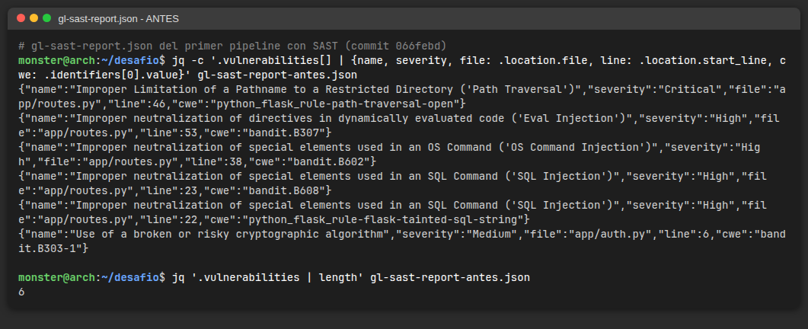
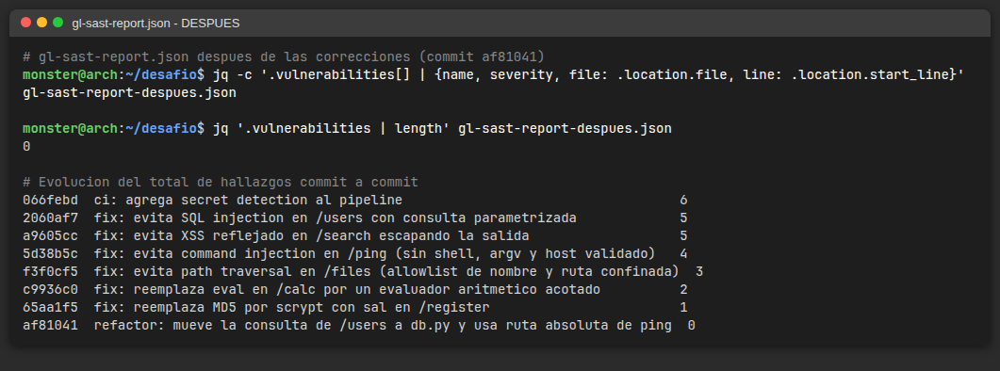
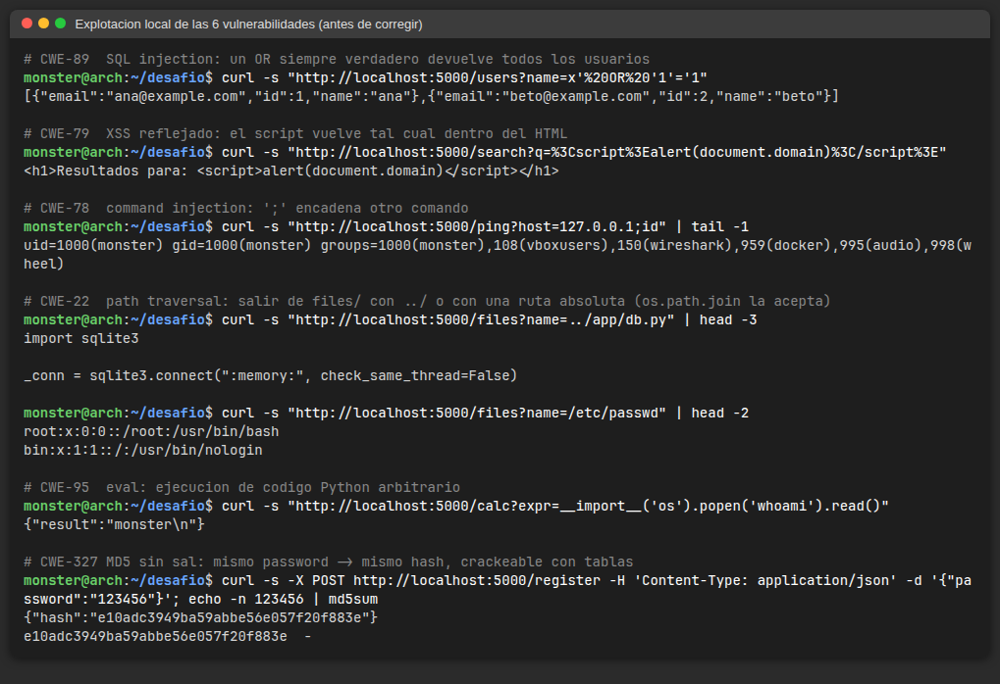
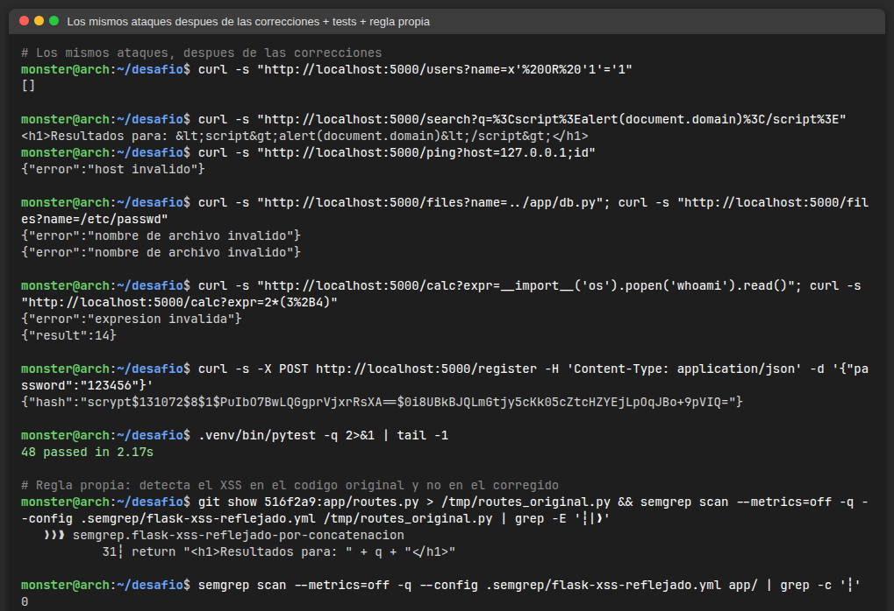

# Mi análisis — Desafío SAST en CI/CD (Python)

> **Plataforma:** todavía no tengo acceso al GitLab de la cátedra, así que el repo está en **GitHub**. Para que el resultado sea comparable con GitLab, el workflow de GitHub Actions (`.github/workflows/ci.yml`) corre **las mismas imágenes oficiales de los analizadores de GitLab** (`registry.gitlab.com/security-products/semgrep:5` y `.../secrets:6`) y publica los mismos artifacts (`gl-sast-report.json`, `gl-secret-detection-report.json`). El `.gitlab-ci.yml` con los `include` de los templates está en la raíz, listo para cuando se migre. En GitHub el "Merge Request" es un **Pull Request** de `sast` → `main`.
>
> Modalidad: **individual**.

## Nivel 1 — SAST en el pipeline

| Job | Stage | Qué hace | Artifact |
|---|---|---|---|
| `install` | build | `pip install -r requirements.txt` | — |
| `unit-tests` | test | `pytest -q` (48 tests, incluye los de seguridad) | — |
| `sast` | test | Analizador Semgrep de GitLab + **gate** que falla ante hallazgos Medium o mayores | `gl-sast-report.json` |
| `semgrep-custom` | test | Regla propia de Semgrep (`.semgrep/`) con sus tests | — |
| `secret_detection` | test | Analizador de secretos de GitLab (Gitleaks + reglas de GitLab) | `gl-secret-detection-report.json` |

`SAST_EXCLUDED_PATHS` queda explícito con el valor por defecto de GitLab (`spec, test, tests, tmp`). Probé el analizador sin esa variable y aparecen 4 hallazgos extra `B101 assert_used` en `tests/test_app.py`. Son **falsos positivos**: usar `assert` en un test de pytest es lo correcto, el riesgo de Bandit (que `python -O` borre los asserts) solo aplica a código de producción.

## Nivel 2 — Clasificación de hallazgos

Reporte inicial (primer pipeline con SAST, commit `066febd`), obtenido con:

```bash
jq '.vulnerabilities[] | {name, severity, file: .location.file, line: .location.start_line, cwe: .identifiers[0].value}' gl-sast-report.json
```



| # | Archivo:línea | Tipo (CWE) | Severidad | ¿Verdadero positivo? | Justificación |
|---|---|---|---|---|---|
| 1 | `app/routes.py:46` | Path traversal (CWE-22) | Critical | **Sí** | `name` sale de `request.args` sin ningún control y va a `open(os.path.join(BASE_DIR, name))`. Lo exploté con `../app/db.py` y además con `/etc/passwd`: `os.path.join` descarta la base si el segundo argumento es absoluto |
| 2 | `app/routes.py:53` | Eval injection (CWE-95) | High | **Sí** | `eval(request.args.get("expr"))`: el atacante controla el código entero. `__import__('os').popen('whoami').read()` devolvió el usuario del proceso → RCE |
| 3 | `app/routes.py:38` | OS command injection (CWE-78) | High | **Sí** | `host` se concatena en un string ejecutado con `shell=True`. `127.0.0.1;id` ejecutó `id` |
| 4 | `app/routes.py:23` | SQL injection (CWE-89) | High | **Sí** | Bandit B608: la query se arma concatenando `name`. `x' OR '1'='1` devolvió todos los usuarios |
| 5 | `app/routes.py:22` | SQL injection (CWE-89) | High | **Sí (duplicado)** | Es la **misma** vulnerabilidad que el #4, detectada por otra regla (taint de Flask) en la línea donde se arma el string. Dos hallazgos, un solo bug |
| 6 | `app/auth.py:6` | Algoritmo criptográfico roto (CWE-327) | Medium | **Sí** | MD5 sin sal para contraseñas: `123456` → `e10adc39...`, que aparece en cualquier tabla/buscador de hashes. El atacante no controla el dato, pero la falla es de diseño: se explota cuando se filtra la base |

### Verdadero vs. falso positivo: análisis razonado

El criterio es: **¿el atacante controla el dato que llega a la función riesgosa?**

- **#3 (`subprocess.run(... shell=True)`)** — verdadero: `host` viene directo de la query string y la shell interpreta `;`, `&&`, `$( )`. Si `host` fuera una constante del código, `shell=True` seguiría siendo mala práctica pero no explotable (sería un falso positivo en términos de riesgo).
- **Falso positivo después del fix (SQLi):** con la consulta ya parametrizada (`execute("... WHERE name = ?", (name,))`, commit `2060af7`) desapareció el B608, pero la regla `python_flask_rule-flask-tainted-sql-string` **siguió marcando** la línea. La regla ve "dato del request → `execute()`" y no distingue si el dato va como parámetro o concatenado. El atacante controla `name`, pero llega como **valor**, nunca como SQL: es un falso positivo. En vez de silenciarlo con `# nosemgrep`, moví la consulta a `db.buscar_usuarios_por_nombre()` (commit `af81041`), que además es mejor diseño (capa de datos); la regla es intraprocedural y deja de verlo.
- **B101 en `tests/`** — falsos positivos, ver Nivel 1.
- **Probé también con otras herramientas** (local): `semgrep` con `p/security-audit`+`p/owasp-top-ten` marca `/search` ya corregido (`raw-html-format`) porque ve una concatenación de HTML aunque el dato pase por `markupsafe.escape`: **falso positivo**. Y Bandit marca `B607` (ruta parcial de `ping`), que corregí usando la ruta absoluta.

### Falsos negativos (revisión manual)

| Archivo:línea | Vulnerabilidad | Por qué el SAST no la vio |
|---|---|---|
| `app/routes.py:31` — `GET /search` | **XSS reflejado (CWE-79)** | El ruleset de GitLab no tiene una regla para "string de Flask devuelto como HTML". Probado: `?q=<script>alert(document.domain)</script>` vuelve sin escapar con `Content-Type: text/html`. **Lo cubrí con una regla propia** (ver extras) |
| `wsgi.py:6` | `app.run(host="0.0.0.0")` con el servidor de desarrollo | El analizador de GitLab no lo marca (Semgrep con `p/python` sí). Dentro del contenedor hace falta `0.0.0.0`, así que es un riesgo de despliegue más que de código |
| `GET /ping` | DoS / SSRF ciego | Aun sin inyección, cualquiera puede hacer que el servidor haga ping a cualquier host (escaneo de red interna, uso como reflector). Ningún SAST lo marca porque es una decisión de diseño. Mitigación parcial: `timeout`, `-c 1`, `-W 2`; la completa sería una allowlist de destinos o autenticación |
| `GET /calc` (antes del fix) | DoS por consumo de CPU | Aun con un evaluador "seguro", `9**9**9**9` cuelga el proceso. El SAST solo ve `eval`. Mi evaluador limita largo, profundidad, exponente y magnitud |

## Nivel 3 — Correcciones (las 6)

Un commit por corrección, cada uno con tests de regresión en `tests/test_security.py` (el ataque debe quedar bloqueado y el uso legítimo seguir funcionando):

| Commit | Vulnerabilidad | Corrección | Por qué es segura | Hallazgos |
|---|---|---|---|---|
| — | — | Estado inicial | — | **6** |
| `2060af7` | SQLi `/users` | Consulta parametrizada con `?` | El driver manda la sentencia y el valor por separado: el valor nunca se parsea como SQL, haya las comillas que haya | 5 (queda el FP de taint) |
| `a9605cc` | XSS `/search` | `markupsafe.escape()` + `X-Content-Type-Options: nosniff` + `CSP default-src 'none'` | Encoding de salida para el contexto HTML: `<` → `&lt;`. La CSP es defensa en profundidad: aunque se cuele un script, no puede ejecutarse | 5 (era un falso negativo del SAST) |
| `5d38b5c` | Command injection `/ping` | Sin shell, argv como lista, host validado (IP con `ipaddress` o hostname RFC 1123), `timeout` | Sin shell no hay quien interprete `;` o `$( )`; la allowlist además impide argumentos que empiecen con `-` (inyección de opciones de `ping`) | 4 |
| `f3f0cf5` | Path traversal `/files` | Allowlist de nombre (`^[A-Za-z0-9][A-Za-z0-9._-]{0,99}$`) + `realpath` + `commonpath` contra la base | Dos controles independientes: el nombre no puede tener `/`, ni empezar con `.`; y aunque pasara algo, la ruta real (symlinks resueltos) tiene que quedar dentro de `files/` | 3 |
| `c9936c0` | Eval `/calc` | `app/calc.py`: parser con `ast` y allowlist de nodos (números, `+ - * / // % **`, paréntesis) | No se ejecuta código: se recorre el árbol y cualquier nodo fuera de la lista (nombres, llamadas, atributos) se rechaza. Límites de largo, profundidad, exponente y magnitud contra DoS | 2 |
| `65aa1f5` | MD5 `/register` | `hashlib.scrypt` (N=2^17, r=8, p=1, parámetros de OWASP), sal de 16 bytes con `secrets`, verificación con `hmac.compare_digest` | KDF lenta y con costo de memoria: cada intento de fuerza bruta cuesta ~100 ms y 128 MB; la sal hace inútiles las tablas precalculadas y que dos usuarios con la misma clave tengan hashes distintos | 1 |
| `af81041` | (FP de SQLi) | Consulta a `db.py`, ruta absoluta de `ping` | Ver análisis de FP arriba | **0** |



Explotación antes y después:




Los reportes completos están en `reportes/gl-sast-report-antes.json` y `reportes/gl-sast-report-despues.json`.

## Secret detection

- El job `secret_detection` corre el analizador de GitLab y publica `gl-secret-detection-report.json`.
- **Primer hallazgo: un falso positivo.** Al correrlo por primera vez (en local, antes de subir) reportó `AWS access token` en `CONSIGNA.md:162`: es la clave de ejemplo `AKIAIOSFODNN7…EXAMPLE` que trae el propio enunciado (acá la escribo cortada para no generar otro hallazgo). No es una credencial, así que excluí ese archivo con `SECRET_DETECTION_EXCLUDED_PATHS: "CONSIGNA.md"` (variable soportada por el template). Dato interesante: el Gitleaks "pelado" tiene esa clave en su allowlist y no la marca; las reglas de GitLab sí.
- **Prueba con credencial falsa:** ver la sección "Prueba de secret detection" del PR. En la rama `test/secret-detection` agregué `AWS_SECRET_ACCESS_KEY = "<la clave de ejemplo de la consigna>"` en `app/config_prueba.py`; el job la reportó y el pipeline falló. Después la borré en otro commit y el job volvió a verde.
- **Por qué hay que rotar:** el job escanea el árbol actual, así que después del commit que la borra ya no la ve, pero la credencial **sigue en el historial de git** (`git log -p` la muestra, y cualquiera que haya clonado o forkeado la tiene). Borrarla del código no la des-filtra: si fuera real, el paso correcto es **revocarla/rotarla** en el proveedor primero, y recién después limpiar el historial si hace falta. Por eso además dejé la rama sin mergear.

## Extras (opcionales)

- **El SAST falla el pipeline:** step `gate` en el job `sast` (y job `sast-gate` en `.gitlab-ci.yml`) que falla si hay algún hallazgo `Critical`, `High` o `Medium`. Lo activé al final, cuando el reporte quedó en 0: a partir de ahí cualquier regresión rompe el pipeline del PR.
- **`SAST_EXCLUDED_PATHS`** explícito para no analizar `tests/`.
- **Regla propia de Semgrep:** `.semgrep/flask-xss-reflejado.yml`, regla de *taint* que sigue un parámetro de `request.args`/`form`/`values` hasta un `return` que concatena HTML, y considera sanitizadores a `markupsafe.escape`, `html.escape` y `render_template`. Tiene sus casos de prueba en `.semgrep/flask-xss-reflejado.py` (`semgrep --test`). Detecta el XSS de `/search` en el código original (el falso negativo de GitLab) y no marca la versión corregida. Corre en el job `semgrep-custom` con `--error`.

## Límites del SAST (lo que aprendí)

- **Falsos negativos:** el XSS de `/search` pasó sin ser detectado, y ninguna herramienta ve fallas de lógica (por ejemplo, un `/ping` abierto a cualquier destino). "0 hallazgos" no significa "0 vulnerabilidades".
- **Falsos positivos:** una regla de taint marcó una consulta ya parametrizada; hay que revisar cada hallazgo con el criterio de "¿quién controla el dato y cómo llega al sink?" en vez de silenciar en bloque.
- **Duplicados:** un mismo bug puede aparecer dos veces con reglas distintas (SQLi #4 y #5), así que la cantidad de hallazgos no es igual a la cantidad de vulnerabilidades.
- **Complementos:** tests de seguridad (que verifican el comportamiento, no el patrón), DAST contra la app levantada y revisión manual.
